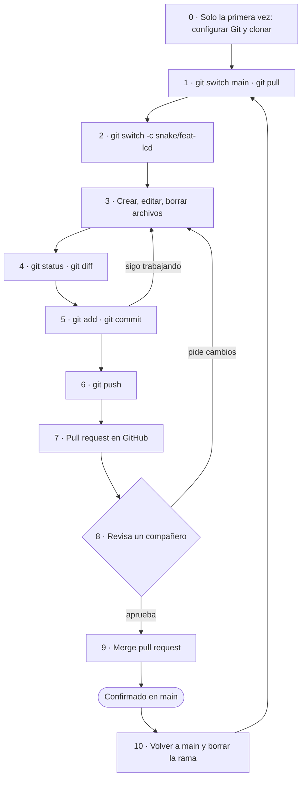

# Guía Git: del cambio en tu PC a `main`

> **Obligatorio para los tres.** Si dudas en cualquier paso, vuelve aquí antes de improvisar con Git.
En Windows usa **Git Bash**. Cambia los ejemplos (`snake/feat-lcd`, rutas, mensajes) por lo tuyo.



## 0. Solo la primera vez

Acepta la invitación de colaborador (correo o https://github.com/Erin2231/SED_y_entos_noH2O_G23/invitations).

```bash
git config --global user.name "Tu Nombre"
git config --global user.email "tu_email_de_github"   # debe ser un email de tu cuenta de GitHub
git config --global init.defaultBranch main
git config --global fetch.prune true
git config --global pull.rebase false
git config --global core.autocrlf true

mkdir -p /c/proyectos && cd /c/proyectos               # fuera de OneDrive
git clone https://github.com/Erin2231/SED_y_entos_noH2O_G23.git
cd SED_y_entos_noH2O_G23
```

El primer `git push` abre una ventana para iniciar sesión en GitHub: *Sign in with your browser*.

## 1. Al empezar cada sesión (descargar lo último)

```bash
cd /c/proyectos/SED_y_entos_noH2O_G23
git switch main
git pull
```

## 2. Crear tu rama

```bash
git switch -c snake/feat-lcd            # nueva
git switch snake/feat-lcd && git merge main   # retomar una existente
git fetch && git switch fpga/feat-fsm-monedas # probar la rama de un compañero
```

## 3. Trabajar

Guarda los archivos en su carpeta. Vivado: sin "Copy sources into project". CubeIDE: código entre
`USER CODE BEGIN/END`. Fusion: exporta `.f3d`, `.step` y `.stl` a `cad/fuente|step|stl`.

```bash
git rm ruta/archivo_viejo.vhd
git mv ruta/nombre_viejo.c ruta/nombre_nuevo.c
```

## 4. Revisar

```bash
git status
git diff
```

## 5. Guardar un commit

```bash
git add snake-arcade/lib/lcd_i2c     # o git add -A
git commit -m "snake: inicializa la LCD por I2C"
```

## 6. Subir

```bash
git push -u origin snake/feat-lcd    # primera vez
git push                             # siguientes
```

## 7. Pull request (GitHub web)

*Compare & pull request* → rellenar plantilla → *Reviewers*: un compañero → *Create pull request*.

## 8. Revisión

Revisor: `git fetch && git switch snake/feat-lcd && git pull`, prueba, y en el PR
*Files changed → Review changes → Approve → Submit review*.
Si piden cambios: pasos 4 a 6 en la misma rama.

## 9. Fusionar

*Merge pull request → Confirm merge → Delete branch*. Ya está confirmado en `main`.

## 10. Limpiar

```bash
git switch main
git pull
git branch -d snake/feat-lcd
git log --oneline -5
```

## Problemas frecuentes

| Problema | Solución |
| --- | --- |
| Conflicto | Edita el archivo (VS Code: *Accept current/incoming/both*), `git add archivo`, `git commit`, `git push`. En `.xpr`, `.ioc`, `.f3d` elegid una versión entera. |
| Deshacer cambios no guardados | `git restore archivo` · sacar del add: `git restore --staged archivo` |
| `push` *rejected* | `git pull` y `git push` |
| Commits en `main` sin querer | `git switch -c rama-nueva` · `git switch main` · `git reset --hard origin/main` · `git switch rama-nueva` |
