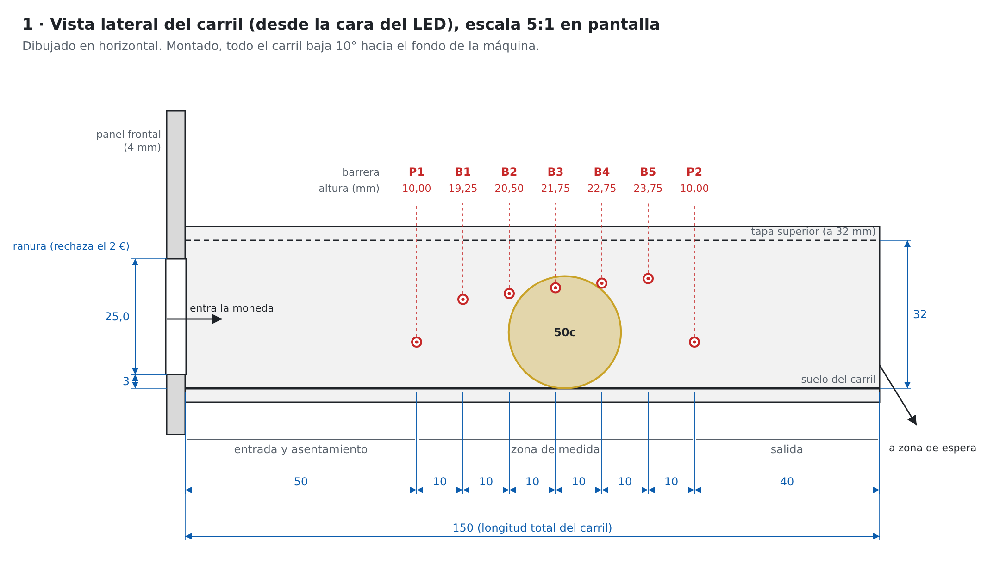
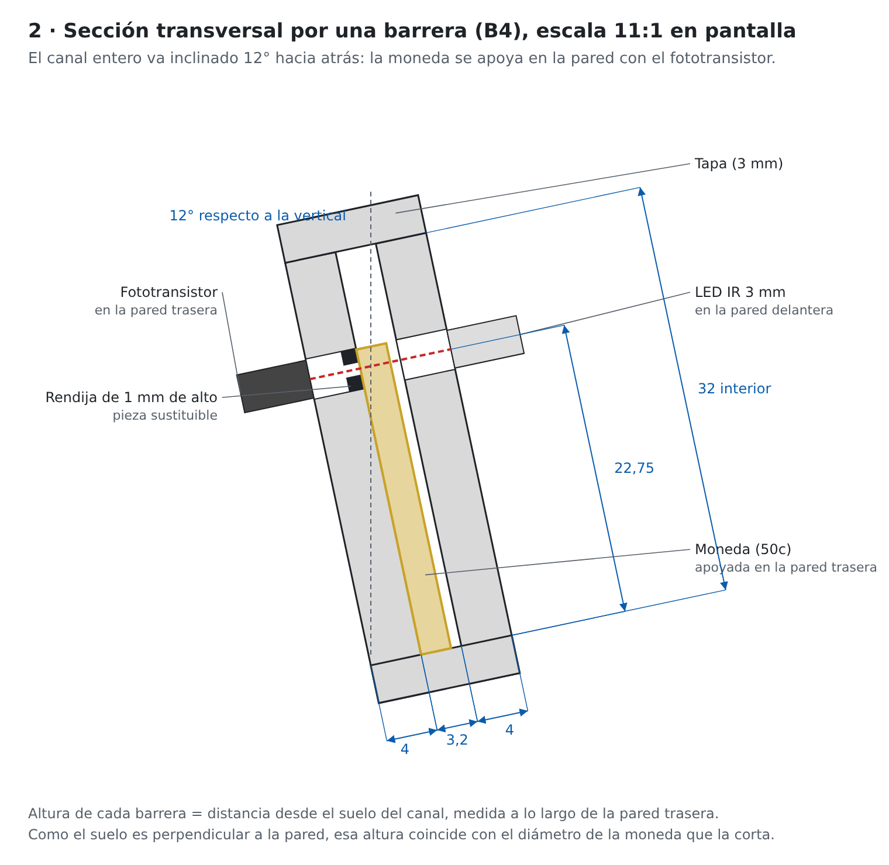
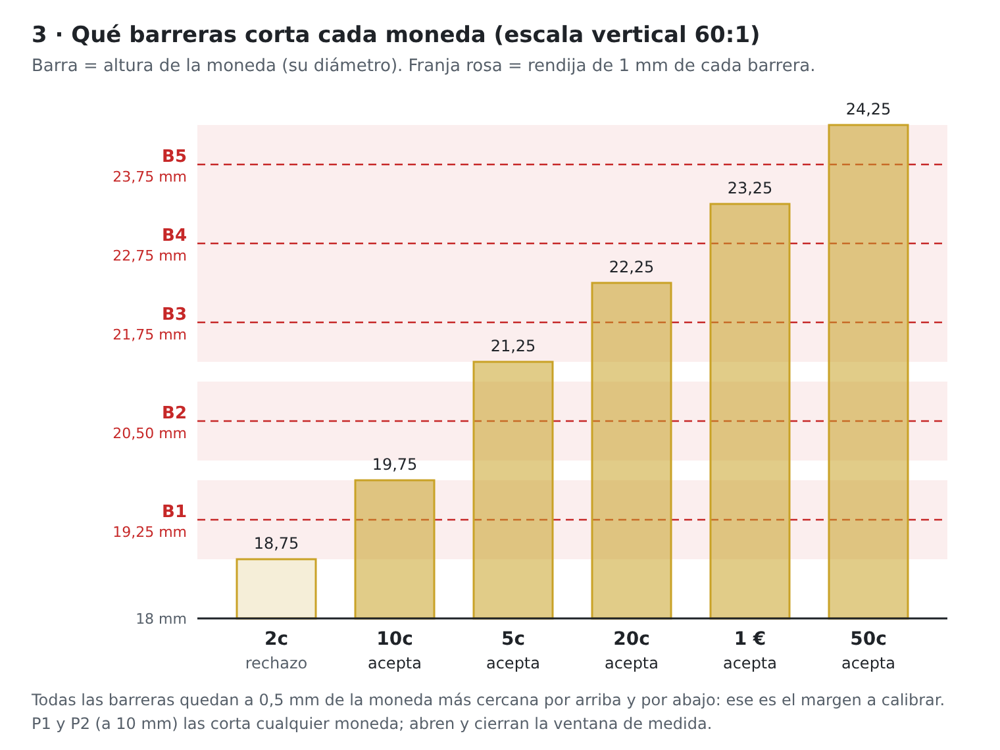
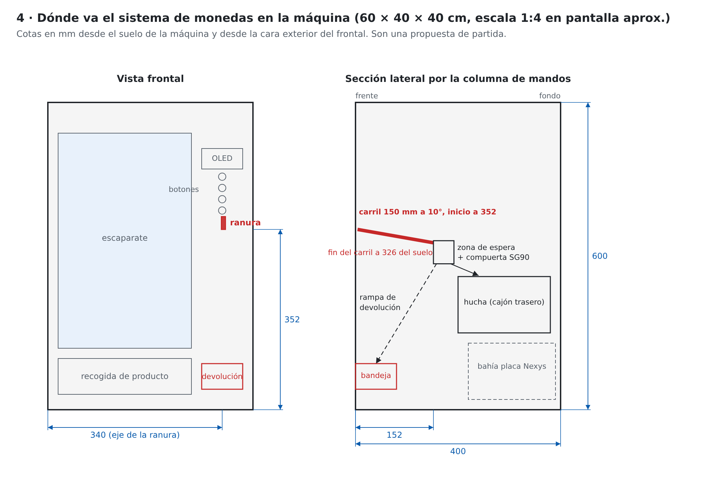
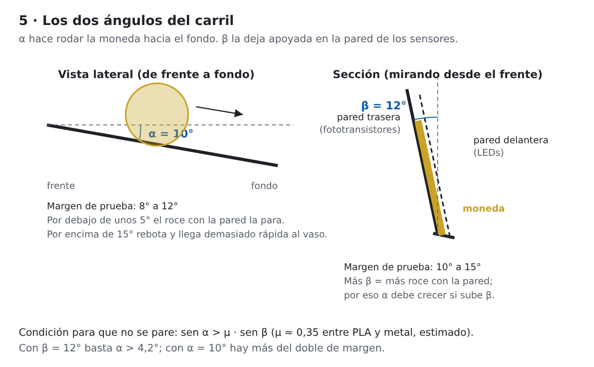
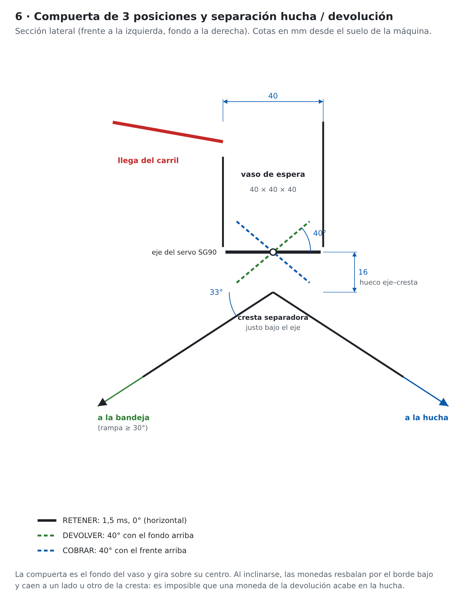

# Rampa de monedas (opción A): planos y montaje

Estado: propuesta para el primer prototipo (2026-11-11). **Todas las cotas en mm.** Los diámetros
de las monedas son aproximados: medidlos con calibre y corregid las alturas antes de imprimir.

## Resumen

- Carril de **150 mm**, inclinado **10°** hacia el fondo de la máquina.
- Canal de **3,2 mm** de ancho y **32 mm** de alto, inclinado **12°** hacia atrás para que la moneda
  ruede apoyada en la pared trasera.
- **7 barreras IR**: dos de presencia (P1 y P2) que abren y cierran la medida, y cinco (B1 a B5) a
  distintas alturas que miden el diámetro.
- Ranura de entrada de **25,0 × 3,2 mm**: el 2 € (25,75 mm) no cabe.
- Acepta **5c, 10c, 20c, 50c y 1 €**. Rechaza 1c, 2c y 2 €.
- Trampilla con servo de 3 posiciones y una cresta en Λ que separa la rampa de la hucha de la de devolución.

## 1. Vista lateral

| Barrera | Posición a lo largo del carril | Altura sobre el suelo del canal | Función |
| --- | --- | --- | --- |
| P1 | 50 | 10,00 | Abre la ventana de medida |
| B1 | 60 | 19,25 | 2c no la corta, 10c sí |
| B2 | 70 | 20,50 | 10c no, 5c sí |
| B3 | 80 | 21,75 | 5c no, 20c sí |
| B4 | 90 | 22,75 | 20c no, 1 € sí |
| B5 | 100 | 23,75 | 1 € no, 50c sí |
| P2 | 110 | 10,00 | Cierra la ventana de medida |

La posición se mide desde la cara interior del panel frontal. Las barreras van separadas **10 mm a lo
largo** porque en altura solo hay entre 1 y 1,25 mm entre ellas, y un LED de 3 mm no cabe en ese hueco.

**¿Por qué dos barreras de presencia?** Una moneda de 24 mm tapa como mucho 2 o 3 barreras a la vez.
Cuando llega a B5, ya ha dejado libre P1. Por eso la ventana de medida va desde que se corta P1 hasta
que se libera P2: durante ese tiempo, la FPGA va apuntando qué barreras B se han cortado alguna vez.

## 2. Sección transversal

- **Pared trasera** (la de abajo, donde se apoya la moneda): fototransistores, cada uno detrás de una
  **rendija de 1 mm de alto** y unos 2 mm de ancho. Lo que define la altura de la barrera es la rendija,
  no el componente.
- **Pared delantera**: LEDs IR de 3 mm en agujeros de 3,1 mm, a la misma altura que su rendija.
- **Suelo perpendicular a la pared trasera.** Así, la altura medida a lo largo de la pared desde el
  suelo es exactamente el diámetro de la moneda que la corta. Medid siempre las alturas así, no en
  vertical.
- **Tapa** a 32 mm, para que ninguna moneda salte fuera del canal.

## 3. Qué corta cada moneda

| B1 | B2 | B3 | B4 | B5 | Moneda | Resultado |
| --- | --- | --- | --- | --- | --- | --- |
| 0 | 0 | 0 | 0 | 0 | 1c o 2c | Rechazo |
| 1 | 0 | 0 | 0 | 0 | 10c | 10 |
| 1 | 1 | 0 | 0 | 0 | 5c | 5 |
| 1 | 1 | 1 | 0 | 0 | 20c | 20 |
| 1 | 1 | 1 | 1 | 0 | 1 € | 100 |
| 1 | 1 | 1 | 1 | 1 | 50c | 50 |
| Cualquier otro | | | | | Error de lectura | Rechazo |

Siempre es un **código termómetro**: si aparece un 1 encima de un 0 (por ejemplo B3 sin B2), hay un
sensor sucio o mal calibrado y se rechaza la moneda.

## Aceptamos el 5c

Decisión del 2026-11-11: el 5c se acepta. Los sensores no cambian; solo cambia la tabla de
`detector_monedas`, que ahora da `coin_value` = 5 para el código B1+B2. Consecuencias:

- El crédito avanza de 5 en 5 céntimos. Un registro de 8 bits en céntimos llega a 2,55 €, de sobra.
- Siguen rechazándose el 1c y el 2c (no cortan B1) y el 2 € (no cabe por la ranura).
- El vaso de espera debe aguantar hasta 20 monedas de 5c para un precio de 1 €: unos 34 mm de
  altura de pila. Con un vaso de 40 × 40 × 40 entra justo; si subís los precios, hacedlo más alto.

## 4. Ubicación en la máquina

- La columna de mandos va a la derecha del frontal (unos 100 mm de ancho), y el carril va de delante
  hacia atrás, detrás de la ranura.
- La ranura queda con su borde inferior a **352 mm** del suelo, a la altura de la mano. El carril
  termina a unos **326 mm**, sobre la zona de espera.
- **Zona de espera**: un vaso de unos 30 × 30 × 40 mm (caben 10 monedas de 10c) cuyo fondo es la
  compuerta del servo SG90. Se inclina hacia atrás para echar las monedas a la hucha, y hacia delante
  para mandarlas a la rampa de devolución.
- La **hucha** es un cajón que se saca por detrás. La **bandeja de devolución** queda abajo en el frontal.

## 5. Ángulos del carril

| Ángulo | Valor | Margen a probar | Para qué |
| --- | --- | --- | --- |
| α, pendiente del carril (de frente a fondo) | **10°** | 8° a 12° | Que la moneda ruede sola hasta el vaso |
| β, inclinación lateral del canal | **12°** respecto a la vertical | 10° a 15° | Que la moneda vaya apoyada en la pared de los fototransistores |

**Cómo se relacionan.** Al apoyarse en la pared, la moneda roza con ella y se frena. Para que no se
pare hace falta que sen α > μ · sen β, siendo μ el rozamiento entre el PLA y el metal (estimado en
0,35). Con β = 12° basta α > 4,2°, así que α = 10° deja más del doble de margen. Si subís β, subid
también α.

**Velocidad estimada.** Contando ese roce, la moneda sale del carril a unos 0,45 m/s y tarda unos
90 ms en cruzar cada barrera. La FPGA lo mide sin problema, y la moneda llega al vaso sin rebotar
demasiado.

**El canal la mantiene vertical.** Con 3,2 mm de hueco y una moneda de 2,4 mm de grosor, la moneda
solo puede inclinarse unos 2° respecto a la pared. Por eso β no hace falta para que no se caiga,
sino para que siempre se apoye en el **mismo** lado, el de los sensores. Así las rendijas leen
siempre a la misma distancia.

## 6. Compuerta y separación hucha / devolución

**Idea:** el fondo del vaso de espera es una trampilla que gira sobre su centro, movida por el servo.
Justo debajo del eje hay una **cresta en forma de Λ**, que divide el espacio en dos rampas. Al
inclinarse, las monedas resbalan por el borde que queda abajo y caen a un lado u otro de la cresta.
Una moneda nunca puede caer en el lado equivocado.

| Posición | Pulso del servo (aprox.) | Trampilla | Destino | Estados de la FSM |
| --- | --- | --- | --- | --- |
| Retener | 1,5 ms | Horizontal | Se quedan en el vaso | PAGO, EVALUAR, DISPENSAR |
| Devolver | unos 1,06 ms | 40°, fondo arriba | Rampa delantera → bandeja | DEVOLVER, ERROR, REPOSO |
| Cobrar | unos 1,94 ms | 40°, frente arriba | Rampa trasera → hucha | COBRAR |

Los pulsos suponen unos 90° por milisegundo, lo típico de un SG90. Calibradlos con el servo real:
`pwm_servo` debería tener las tres posiciones como constantes fáciles de cambiar.

**Medidas clave:**

- **Trampilla:** 38 × 38 mm, de 2 mm de grosor, sobre el eje del servo. Holgura con las paredes
  del vaso de 0,8 mm como máximo: la moneda más fina (5c, unos 1,67 mm) no debe poder encajarse
  de canto en la rendija.
- **40° de giro:** el rozamiento metal-PLA necesita más de unos 20° para que resbalen; 40° asegura
  que caigan todas, incluso apiladas.
- **Cresta:** 16 mm por debajo del eje. Así los extremos de la trampilla, al girar, nunca la tocan.
- **Rampas:** al menos 30° (33° en el dibujo). La de devolución baja hasta la bandeja del frontal
  (unos 200 mm de caída). Poned un **escalón o zigzag** a mitad de camino y una almohadilla de
  fieltro o TPU al final, para que las monedas no salgan disparadas ni hagan ruido.
- **Hucha:** la rampa trasera desemboca en la boca del cajón. El cajón se saca por detrás.
- **Servo:** atornillado a la pared lateral del vaso, con el eje alineado con el centro de la
  trampilla. La trampilla se encaja en el brazo del servo, y por el otro lado gira sobre un
  pasador de 3 mm.

**Tiempos en la FSM:** en COBRAR y DEVOLVER, la trampilla se queda inclinada 1 s (con el
`temporizador`) y vuelve a retener. Así da tiempo a que caiga hasta la última moneda.

**Extra opcional:** una barrera IR en cada rampa confirma que las monedas han salido. Si en
DEVOLVER no pasa nada, es que se ha atascado algo y la FSM puede avisar.

## Cómo montar y calibrar las barreras

1. **Imprimir el carril tumbado** (la pared trasera sobre la cama) para que el suelo y las paredes
   salgan rectos y lisos. Las rendijas van en piezas aparte.
2. **Portasensores regulables.** Cada fototransistor va en una pieza pequeña que desliza en una ranura
   vertical de la pared trasera, con un tornillo M2 o M3 para fijarla. Recorrido de unos ±1,5 mm.
3. **Calibrar con monedas reales**, de una en una, y siempre con el carril ya inclinado:
    1. Colocad la moneda parada frente a la barrera (sujeta con un palillo).
    2. Medid la tensión del fototransistor con el polímetro: tapado y destapado.
    3. Subid o bajad el portasensor hasta que la moneda que **debe** cortarla la tape del todo y la
       inmediatamente más pequeña la deje libre.
    4. Apretad el tornillo y marcad la posición.
4. **Luz ambiente.** Pintad de negro mate el interior del canal o imprimidlo en PLA negro. La tapa
   también evita que entre luz del techo.
5. **Electrónica de cada barrera:** LED IR con resistencia de unos 220 Ω a 5 V (unos 15 mA), y
   fototransistor con pull-up de 10 kΩ a **3,3 V**, con la salida directa a un pin del Pmod. La FPGA
   la sincroniza y la filtra (`sincronizador` y `antirrebote`). Si la señal es muy lenta o ruidosa,
   se puede añadir un 74HC14 (Schmitt trigger) alimentado a 3,3 V.

## Qué hace el VHDL (`detector_monedas`)

1. Espera a que se corte **P1**.
2. Mientras tanto, acumula con un OR qué barreras B1 a B5 se han cortado.
3. Cuando **P2** vuelve a quedar libre, lee el código, emite `coin_valid` y `coin_value` (o
   `coin_reject`) durante un ciclo, y se reinicia.
4. Si pasa demasiado tiempo (por ejemplo 1 s) sin que se libere P2, hay un atasco: emite
   `coin_reject` y avisa del error.
5. Si se vuelve a cortar P1 antes de que se libere P2, han entrado dos monedas seguidas: rechazo.

**Una moneda rechazada** cae a la misma zona de espera que las buenas. La solución más sencilla es
tratarla como un error: la FSM pasa a ERROR y devuelve todo el dinero retenido. Si queréis devolver
solo la moneda falsa, haría falta un segundo servo a la salida del carril.

## Material para este módulo

- 8 parejas de LED IR de 3 mm a 940 nm y fototransistor (7 para el carril y 1 de repuesto). La
  barrera de caída de producto va aparte.
- 7 resistencias de 220 Ω y 7 de 10 kΩ.
- Tornillos M2 o M3 cortos para los portasensores.
- PLA negro.
- Pines: 7 entradas, todas en el **Pmod JC**.

## Pruebas del primer prototipo

- [ ] Medir las 8 monedas con calibre y corregir las alturas
- [ ] Imprimir solo un tramo de 60 mm con P1 y B4 y probar con un 20c y un 1 €
- [ ] Comprobar que la moneda rueda sin rebotar a 10° (probar también 8° y 12°)
- [ ] Imprimir el carril completo y calibrar las 7 barreras
- [ ] Pasar 20 monedas de cada tipo y anotar los aciertos en esta ficha

Los dibujos se generan con `cad/rampa-monedas/generar_planos.py`: si cambiáis una cota, cambiadla
allí y volved a ejecutarlo para que planos y documentación sigan iguales.
